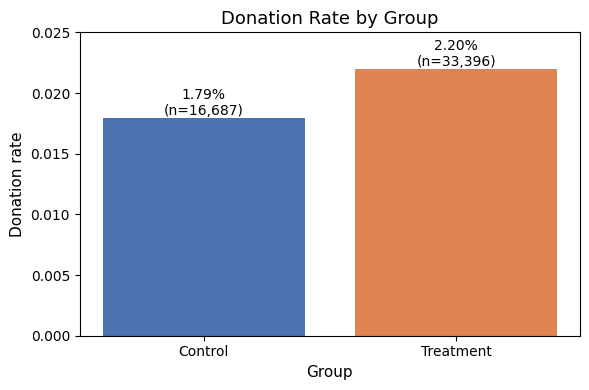
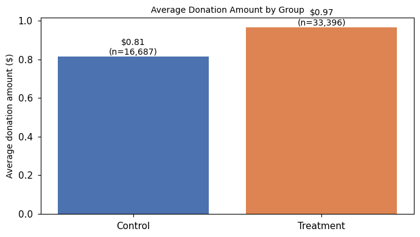
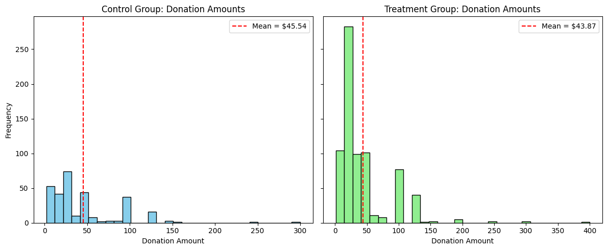
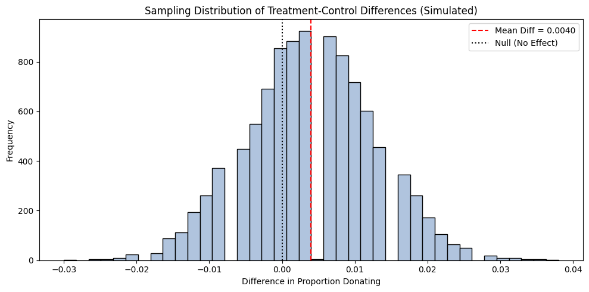
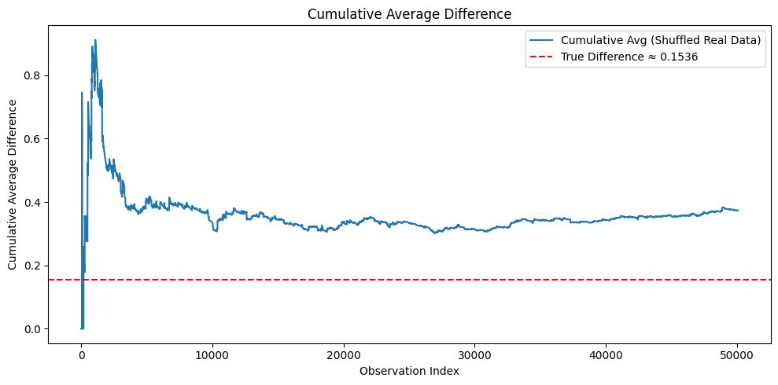
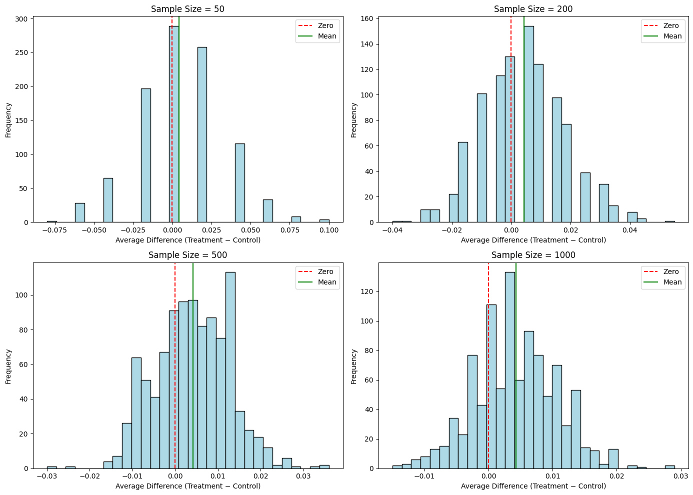

::: {.biz-value}
### Test Results

- **Question:** Does offering to match donations increase giving, and does a bigger match (2:1 or 3:1) work better than 1:1?
- **Data:** 50,083 past donors randomly assigned in a published field experiment (Karlan & List, 2007).
- **Finding:** A match offer raised the response rate from 1.79% to 2.20%, **+0.42 percentage points, about a 23% relative lift** (p = 0.002). Revenue per letter rose about 19%, from $0.81 to $0.97 (p = 0.06).
- **Decision:** Larger matches did not raise response further (2.07%, 2.26%, 2.27% for 1:1, 2:1, 3:1). Because a 3:1 match costs the matching donor three times as much, the cheapest ratio is the sensible default. "No significant difference" is not proof the ratios are equal.
:::

## The Question

Fundraisers routinely advertise that a large donor will match gifts. Does the offer actually change behavior, and does a richer match change it more? Karlan and List (2007) answered this with a field experiment. This project replicates their core analysis from the original data and turns it into a pricing decision: how much incentive is worth paying for?

The same question appears in banking when testing a rate discount or fee waiver: does the incentive move customers, and is a bigger incentive worth its cost?

## Experimental Design

More than 50,000 previous donors to a U.S. nonprofit received fundraising letters and were randomly assigned:

- **Control (one third):** a standard letter.
- **Treatment (two thirds):** the same letter plus a matching-gift offer, further randomized by
  - match ratio: 1:1, 2:1, or 3:1
  - maximum match amount: $25,000, $50,000, $100,000, or unstated
  - suggested donation: the donor's highest previous gift, or 1.25× or 1.5× that amount

Random assignment means any difference in outcomes can be attributed to the letter, provided the groups really are comparable. That is checked first.

```{python}
#| echo: false
import pandas as pd

df = pd.read_stata("karlan_list_2007.dta")
df.head()
```

:::: {.callout-note collapse="true" title="Variable definitions"}

| Variable             | Description                                                         |
|----------------------|---------------------------------------------------------------------|
| `treatment`          | Treatment                                                           |
| `control`            | Control                                                             |
| `ratio`              | Match ratio                                                         |
| `ratio2`             | 2:1 match ratio                                                     |
| `ratio3`             | 3:1 match ratio                                                     |
| `size`               | Match threshold                                                     |
| `size25`             | \$25,000 match threshold                                            |
| `size50`             | \$50,000 match threshold                                            |
| `size100`            | \$100,000 match threshold                                           |
| `sizeno`             | Unstated match threshold                                            |
| `ask`                | Suggested donation amount                                           |
| `askd1`              | Suggested donation was highest previous contribution                |
| `askd2`              | Suggested donation was 1.25 x highest previous contribution         |
| `askd3`              | Suggested donation was 1.50 x highest previous contribution         |
| `ask1`               | Highest previous contribution (for suggestion)                      |
| `ask2`               | 1.25 x highest previous contribution (for suggestion)               |
| `ask3`               | 1.50 x highest previous contribution (for suggestion)               |
| `amount`             | Dollars given                                                       |
| `gave`               | Gave anything                                                       |
| `amountchange`       | Change in amount given                                              |
| `hpa`                | Highest previous contribution                                       |
| `ltmedmra`           | Small prior donor: last gift was less than median \$35              |
| `freq`               | Number of prior donations                                           |
| `years`              | Number of years since initial donation                              |
| `year5`              | At least 5 years since initial donation                             |
| `mrm2`               | Number of months since last donation                                |
| `dormant`            | Already donated in 2005                                             |
| `female`             | Female                                                              |
| `couple`             | Couple                                                              |
| `state50one`         | State tag: 1 for one observation of each of 50 states; 0 otherwise  |
| `nonlit`             | Nonlitigation                                                       |
| `cases`              | Court cases from state in 2004-5 in which organization was involved |
| `statecnt`           | Percent of sample from state                                        |
| `stateresponse`      | Proportion of sample from the state who gave                        |
| `stateresponset`     | Proportion of treated sample from the state who gave                |
| `stateresponsec`     | Proportion of control sample from the state who gave                |
| `stateresponsetminc` | stateresponset - stateresponsec                                     |
| `perbush`            | State vote share for Bush                                           |
| `close25`            | State vote share for Bush between 47.5% and 52.5%                   |
| `red0`               | Red state                                                           |
| `blue0`              | Blue state                                                          |
| `redcty`             | Red county                                                          |
| `bluecty`            | Blue county                                                         |
| `pwhite`             | Proportion white within zip code                                    |
| `pblack`             | Proportion black within zip code                                    |
| `page18_39`          | Proportion age 18-39 within zip code                                |
| `ave_hh_sz`          | Average household size within zip code                              |
| `median_hhincome`    | Median household income within zip code                             |
| `powner`             | Proportion house owner within zip code                              |
| `psch_atlstba`       | Proportion who finished college within zip code                     |
| `pop_propurban`      | Proportion of population urban within zip code                      |

::::

## Randomization Check

If randomization worked, donor characteristics measured before the letter should not differ between groups. Each was tested with a two-sample t-test and an equivalent regression on the treatment indicator:

| Pre-treatment variable | Treatment − control | t | p-value | 95% CI |
|:-----------------------|--------------:|-------:|--------:|:------:|
| Months since last donation (`mrm2`) | 0.0137 | 0.12 | 0.905 | −0.211 to 0.238 |
| Years since first donation (`years`) | −0.0575 | −1.10 | 0.270 | −0.160 to 0.045 |
| Number of prior donations (`freq`) | −0.0120 | −0.11 | 0.912 | −0.224 to 0.200 |
| Female (`female`) | −0.0075 | −1.76 | 0.079 | −0.016 to 0.001 |

None of the differences is significant at the 5% level, matching Table 1 of the original paper. The groups are comparable, so the outcome differences below can be read as effects of the letter.

## Result 1: The Match Offer Raises Response

**Figure 1. Response rate by group**
{#fig-donation-rate}

| Estimate | Effect on response rate | p-value | 95% CI |
|:---------|------------------------:|--------:|:------:|
| Linear probability model | +0.42 pp | 0.002 | +0.15 to +0.68 pp |
| Probit, average marginal effect | +0.43 pp | 0.002 | +0.16 to +0.70 pp |

The response rate rises from **1.79% to 2.20%**. In absolute terms that is small, but relative to the low baseline it is a **23% lift**, and the two models agree.

**Figure 2. Average donation per letter (including non-donors)**
{#fig-avg-donation}

Revenue per letter mailed rises from **$0.81 to $0.97** (+$0.15, about 19%). That estimate is less precise (p = 0.06), because donation amounts vary far more than the yes/no decision to give.

## Result 2: Bigger Matches Do Not Help

Within the treatment group:

| Match ratio | Response rate | Difference vs. 1:1 | p-value |
|:-----------:|--------------:|-------------------:|--------:|
| 1:1 | 2.07% | — | — |
| 2:1 | 2.26% | +0.19 pp | 0.335 |
| 3:1 | 2.27% | +0.20 pp | 0.310 |

Going from 2:1 to 3:1 changes response by 0.01 points (p = 0.96). A regression on ratio indicators gives the same answer (p = 0.338 and 0.313). The offer of a match matters; its size does not, at least within this range. Since a 3:1 match commits three times the matching funds, **1:1 delivers the same response at the lowest cost**.

## Result 3: Matches Bring In More Donors, Not Bigger Gifts

Among the 1,034 people who donated, the average gift was **$45.54 in the control group and $43.87 in the treatment group** (difference −$1.67, p = 0.56). The higher revenue per letter therefore comes from more people giving, not from larger gifts.

This comparison conditions on donating, which happened after randomization, so it describes donors rather than measuring a clean causal effect.

**Figure 3. Distribution of gift sizes among donors**
{#fig-donation-dist}

## Why Sample Size Matters

A 0.4-point effect on a 2% base is hard to detect. Simulations show why this experiment needed tens of thousands of letters.

**Figure 4. Simulated treatment–control differences, 500 donors per group**
{#fig-sampling-dist}

Across 10,000 simulated experiments with response rates of 1.8% and 2.2%, the estimated difference is centered on the true 0.4 points but spreads widely around zero. With only 500 donors per group, many experiments would show no effect, or even the wrong sign.

**Figure 5. Running estimate of the difference as observations accumulate (law of large numbers)**
{#fig-lln}

**Figure 6. Sampling distributions at n = 50, 200, 500, and 1,000 per group (central limit theorem)**
{#fig-clt}

As the sample grows, the running estimate settles on the full-sample difference and the sampling distributions narrow and become approximately normal. That is what makes a t-test valid here, and why small tests of low-response campaigns are often inconclusive.

## Takeaways and Limitations

- **Offer a match; keep it at 1:1.** The match offer lifts response by about 23%, and larger ratios add cost without adding response.
- **Measure the right outcome.** The gain comes from more donors, not larger gifts, so participation is the metric to optimize.
- **Plan sample sizes up front.** With a 2% baseline, detecting a 0.4-point lift requires thousands of observations per group.
- **Limitations:** the experiment involved one nonprofit's past donors in 2005, which may limit how far the results generalize. Several comparisons were run, so the borderline result (revenue per letter, p = 0.06) should be treated as suggestive. The match-limit and suggested-amount arms were not analyzed here.
