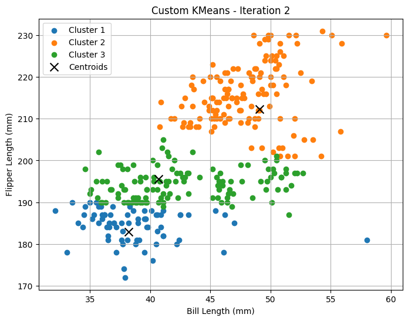
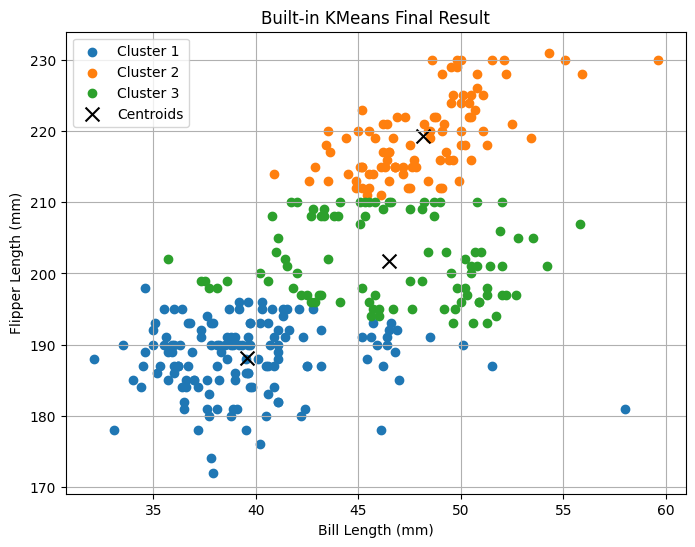
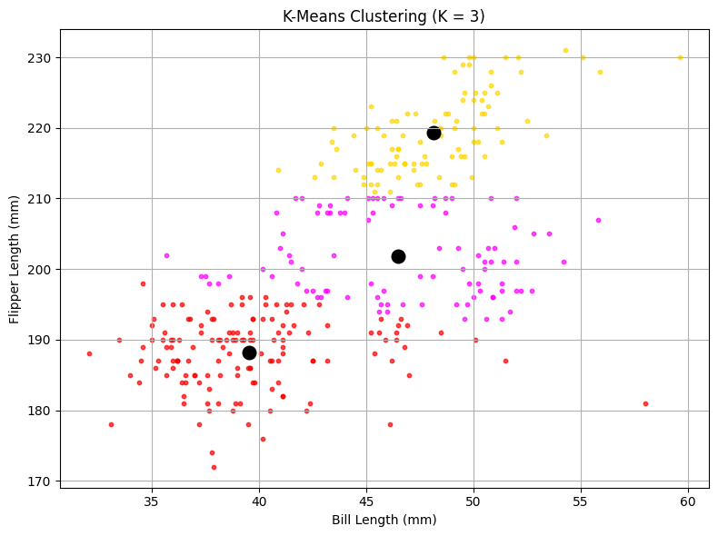

::: {.biz-value}
### Results

- **Question:** Can two body measurements separate penguin species without using the labels, and how should the number of clusters be chosen?
- **Approach:** Wrote K-Means from scratch, validated it against scikit-learn, and compared k = 2–7 with WCSS and silhouette scores.
- **Key finding:** Feature scaling mattered more than the algorithm. Standardizing the two measurements raised agreement with the true species from **0.63 to 0.88** (adjusted Rand index) and recovered Chinstrap penguins as their own cluster.
- **Judgment:** Silhouette slightly prefers k = 2. k = 3 is chosen because, once features are scaled, it costs little separation and matches a real three-group structure. Species labels never enter the fitting.
:::

## The Question

Clustering looks for structure when there is no target variable. This project asks whether two measurements, **bill length** and **flipper length**, are enough to separate the three penguin species in the [Palmer Penguins](https://allisonhorst.github.io/palmerpenguins/) data without seeing the labels. The labels are used only afterwards, to grade the result.

Segmenting customers or borrowers raises the same questions as this project: which features to use, how to scale them, and how many groups the data actually supports.

```{python}
#| echo: false
import pandas as pd
import numpy as np
import matplotlib.pyplot as plt
from sklearn.cluster import KMeans
from sklearn.metrics import silhouette_score, adjusted_rand_score
from sklearn.preprocessing import StandardScaler
```

```{python}
#| echo: false
penguins = pd.read_csv("palmer_penguins.csv")
data = penguins.dropna(subset=["bill_length_mm", "flipper_length_mm"]).reset_index(drop=True)
X = data[["bill_length_mm", "flipper_length_mm"]].to_numpy()
```

## Data

The dataset has 333 penguins with complete measurements: 146 Adélie, 68 Chinstrap, and 119 Gentoo. Clustering uses only `bill_length_mm` and `flipper_length_mm`.

::: {.callout-note collapse="true" title="Data preview (first 5 rows)"}
| species | island     | bill_length_mm | bill_depth_mm | flipper_length_mm | body_mass_g | sex    | year |
|----------|------------|----------------|---------------|-------------------|-------------|--------|------|
| Adelie   | Torgersen  | 39.1 | 18.7 | 181 | 3750 | male   | 2007 |
| Adelie   | Torgersen  | 39.5 | 17.4 | 186 | 3800 | female | 2007 |
| Adelie   | Torgersen  | 40.3 | 18.0 | 195 | 3250 | female | 2007 |
| Adelie   | Torgersen  | 36.7 | 19.3 | 193 | 3450 | female | 2007 |
| Adelie   | Torgersen  | 39.3 | 20.6 | 190 | 3650 | male   | 2007 |
:::

## K-Means From Scratch

K-Means alternates two steps until assignments stop changing: assign each point to its nearest centroid, then move each centroid to the mean of its points. Because the result depends on the random starting centroids, the implementation runs several restarts and keeps the solution with the lowest within-cluster sum of squares (WCSS).

```{python}
#| code-fold: true
#| code-summary: "Code: K-Means implementation"
def kmeans(X, k, n_restarts=10, max_iter=100, seed=0):
    """Lloyd's algorithm with random restarts; returns the lowest-WCSS solution."""
    rng = np.random.default_rng(seed)
    best = None
    for _ in range(n_restarts):
        centroids = X[rng.choice(len(X), size=k, replace=False)]
        for _ in range(max_iter):
            dist = ((X[:, None, :] - centroids[None, :, :]) ** 2).sum(axis=2)
            labels = dist.argmin(axis=1)
            new = np.array([X[labels == j].mean(axis=0) if np.any(labels == j) else centroids[j]
                            for j in range(k)])
            if np.allclose(new, centroids):
                break
            centroids = new
        wcss = ((X - centroids[labels]) ** 2).sum()
        if best is None or wcss < best[2]:
            best = (labels, centroids, wcss)
    return best
```

**Figure 1. Iteration 1:** random starting centroids, with overlapping groups.
{#fig-kmeans-iter1}

**Figure 2. Iteration 2:** one update moves centroids toward the dense regions, and most of the structure appears.
{#fig-kmeans-iter2}

**Figure 3. Converged solution:** centroid movement has stopped.
{#fig-kmeans-final}

### Validation against scikit-learn

```{python}
#| echo: false
labels_c, cent_c, wcss_c = kmeans(X, 3)
sk = KMeans(n_clusters=3, n_init=10, random_state=42).fit(X)
order_c, order_s = np.argsort(cent_c[:, 1]), np.argsort(sk.cluster_centers_[:, 1])
pd.DataFrame({
    "Custom (bill, flipper)": [f"({a:.2f}, {b:.2f})" for a, b in cent_c[order_c]],
    "scikit-learn (bill, flipper)": [f"({a:.2f}, {b:.2f})" for a, b in sk.cluster_centers_[order_s]],
}, index=["Cluster 1", "Cluster 2", "Cluster 3"]).assign(
    **{"Custom WCSS": [round(wcss_c, 1), "", ""], "scikit-learn WCSS": [round(sk.inertia_, 1), "", ""]})
```

With restarts, the custom implementation and scikit-learn reach the same solution. A single K-Means run can stop in a worse local optimum, which is why an earlier version of this analysis showed different centroids for the two implementations.

## Choosing k

```{python}
#| echo: false
Z = StandardScaler().fit_transform(X)
rows = []
for k in range(2, 8):
    raw = KMeans(n_clusters=k, n_init=10, random_state=42).fit(X)
    std = KMeans(n_clusters=k, n_init=10, random_state=42).fit(Z)
    rows.append({"k": k, "WCSS (raw)": round(raw.inertia_, 1),
                 "Silhouette (raw)": round(silhouette_score(X, raw.labels_), 3),
                 "Silhouette (standardized)": round(silhouette_score(Z, std.labels_), 3)})
scores = pd.DataFrame(rows).set_index("k")

fig, ax = plt.subplots(1, 2, figsize=(7.6, 3.2))
ax[0].plot(scores.index, scores["WCSS (raw)"], marker="o", color="#1d1d1f")
ax[0].set(title="WCSS (raw features)", xlabel="k", ylabel="WCSS")
ax[1].plot(scores.index, scores["Silhouette (raw)"], marker="o", label="Raw", color="#86868b")
ax[1].plot(scores.index, scores["Silhouette (standardized)"], marker="o", label="Standardized", color="#0071e3")
ax[1].set(title="Silhouette score", xlabel="k", ylabel="Silhouette")
ax[1].legend(frameon=False)
for a in ax:
    a.spines[["top", "right"]].set_visible(False)
plt.tight_layout()
plt.show()
scores
```

The WCSS curve bends at k = 3, and silhouette is highest at k = 2. On raw features, the gap between k = 2 and k = 3 is large (0.612 vs. 0.480). After standardizing, it nearly disappears (0.539 vs. 0.519), so k = 3 gives up very little separation in exchange for a finer, more useful segmentation.

## Does Scaling Matter?

Flipper length varies about 2.5 times as much as bill length (standard deviation 14.0 mm vs. 5.5 mm), so on raw data it dominates the distance calculation and bill length has little influence on the clusters. Standardizing gives both measurements equal weight. The labels are used here only to grade the clusters, never to fit them:

```{python}
#| echo: false
raw3 = KMeans(n_clusters=3, n_init=10, random_state=42).fit(X)
std3 = KMeans(n_clusters=3, n_init=10, random_state=42).fit(Z)

def species_table(labels):
    tab = pd.crosstab(data["species"], labels)
    tab = tab[tab.idxmax(axis=0).map({"Adelie": 0, "Chinstrap": 1, "Gentoo": 2}).sort_values().index]
    tab.columns = [f"Cluster {i + 1}" for i in range(tab.shape[1])]
    return tab

print(f"Adjusted Rand index vs. species: raw {adjusted_rand_score(data['species'], raw3.labels_):.2f}, "
      f"standardized {adjusted_rand_score(data['species'], std3.labels_):.2f}")
display(species_table(raw3.labels_).rename_axis("Raw features"))
display(species_table(std3.labels_).rename_axis("Standardized"))
```

- **Raw features:** Gentoo separates cleanly, but 54 of 68 Chinstrap penguins share a middle cluster with 38 Adélie penguins, so that cluster is not a single species.
- **Standardized:** each cluster corresponds to one species, and 59 of 68 Chinstrap penguins are grouped together. Adjusted Rand index rises from 0.63 to 0.88.

**Figure 4. Final raw-feature clustering (k = 3)**
{#fig-kmeans-k3}

## Takeaways and Limitations

- **Scale before you cluster.** With distance-based methods, the units of the inputs decide the result. Here, scaling changed the answer more than the choice of k did.
- **Restart K-Means.** A single run can stop in a poor local optimum. Multiple restarts, or k-means++ initialization, should be the default.
- **k is a judgment call.** The metrics narrow the choice; the purpose of the segmentation decides it.
- **Limitations:** only two features are used, and K-Means assumes round, similar-sized clusters. Adding bill depth, or trying a Gaussian mixture model that allows elongated clusters, would be natural next steps.
