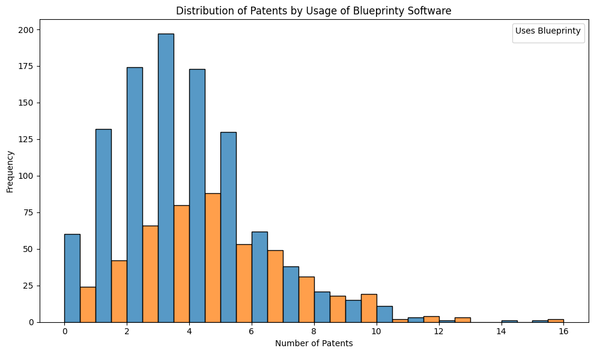
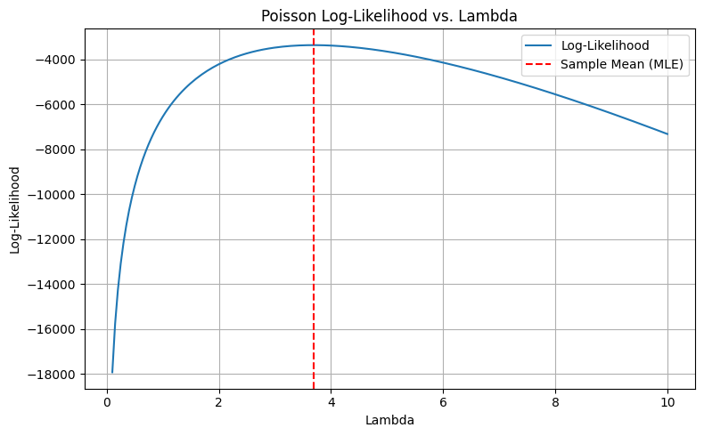
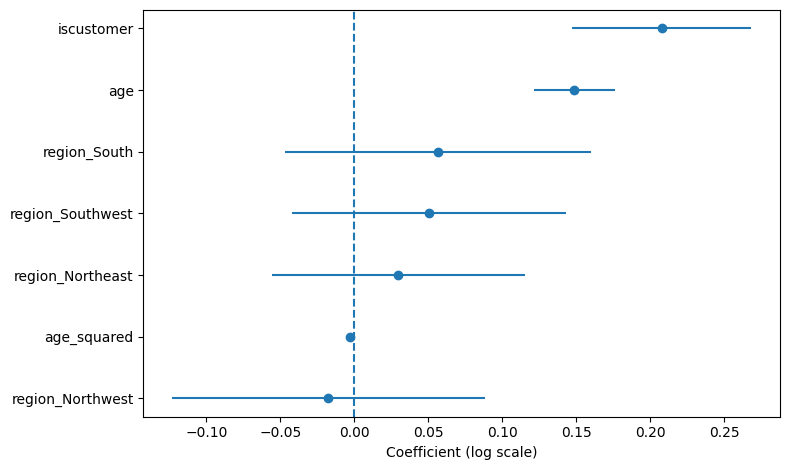
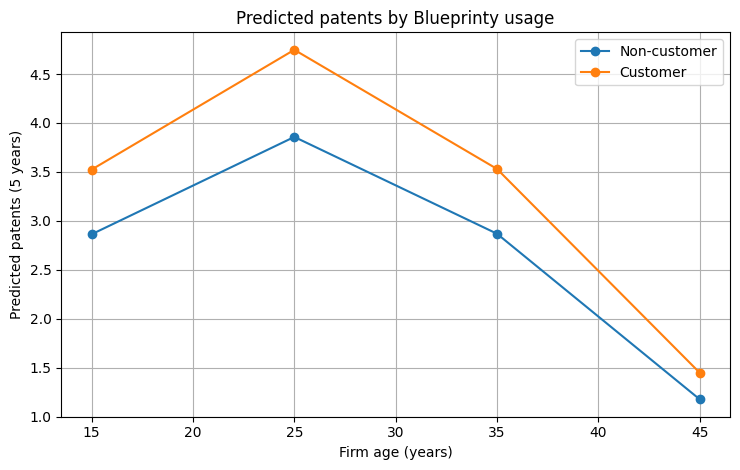

::: {.biz-value}
### Adjusted Association

- **Question:** Do engineering firms that use Blueprinty's software earn more patents, once firm age and region are taken into account?
- **Approach:** Derived the Poisson likelihood, maximized it by hand, and confirmed the result against statsmodels. Then tested the finding under overdispersion with robust standard errors and a negative binomial model.
- **Finding:** Customers have about **23% more expected patents** (incidence rate ratio 1.23, 95% CI 1.15–1.32 across all three specifications), or about **0.8 more patents per firm** over five years.
- **Caveat:** Customers were not randomly assigned, so this is an adjusted association, not proof that the software causes more patents.
:::

## The Question

Blueprinty, a fictional company in this case study, sells software that helps firms prepare patent applications. Its marketing team wants evidence that customers are more successful at getting patents. Approval rates before and after adoption are not available. What is available is a cross-section of 1,500 mature engineering firms: patents awarded over the last five years, region, firm age, and whether the firm uses Blueprinty.

The analysis asks whether customers earn more patents after accounting for age and region, and how confident that conclusion can be.

```{python}
#| warning: false
#| echo: false
import warnings
warnings.filterwarnings("ignore")
```

```{python}
#| echo: false
#| output: false
import pandas as pd
import matplotlib.pyplot as plt
import seaborn as sns
# Read the data 
df = pd.read_csv('blueprinty.csv')

# Check structure of the data
df.head()
```

## Data

::: {.callout-note collapse="true" title="Data dictionary"}
| Variable       | Description |
|:--------------|:------------|
| `patents`      | Number of patents awarded in the last 5 years (count outcome) |
| `region`       | Midwest, Northeast, Northwest, South, or Southwest |
| `age`          | Years since incorporation |
| `iscustomer`   | 1 = Blueprinty customer, 0 = non-customer |
:::

Customers average **4.13** patents over five years versus **3.47** for non-customers. That raw gap cannot be taken at face value, because customers differ from non-customers in ways that may also affect patenting.

```{python}
#| echo: false
#| output: false
# Plot histograms to compare number of patents
plt.figure(figsize=(10, 6))
sns.histplot(data=df, x='patents', hue='iscustomer', multiple='dodge', binwidth=1)
plt.title('Distribution of Patents by Usage of Blueprinty Software')
plt.xlabel('Number of Patents')
plt.ylabel('Frequency')
plt.legend(title='Uses Blueprinty')
plt.tight_layout()
plt.show()
```

**Figure 1. Distribution of patent counts by Blueprinty usage**
{#fig-blueprinty-hist}

Patent counts are right-skewed, as count data usually are, and customers sit modestly further right.

**Firm age by customer status**

| Customer | Firms | Mean age | Median age | SD |
|---------:|------:|---------:|-----------:|---:|
| No  | 1,019 | 26.10 | 25.50 | 6.95 |
| Yes | 481   | 26.90 | 26.50 | 7.81 |

**Region by customer status**

| Region | Non-customers | Customers | Total |
|-----------|-----:|-----:|------:|
| Midwest   | 187 | 37  | 224   |
| Northeast | 273 | 328 | 601   |
| Northwest | 158 | 29  | 187   |
| South     | 156 | 35  | 191   |
| Southwest | 245 | 52  | 297   |
| Total     | 1,019 | 481 | 1,500 |

Age is similar across groups, but region is not: **68% of customers are in the Northeast**, where most non-customers are not. Both variables are therefore controlled for in the model.

## A Baseline Poisson Model

Because patents are non-negative counts, the natural starting point is $Y_i \sim \text{Poisson}(\lambda)$. For $n$ independent firms the log-likelihood is

$$
\ell(\lambda) = -n\lambda + \left(\sum_{i=1}^n y_i\right)\log\lambda - \sum_{i=1}^n \log(y_i!).
$$

Setting the derivative $-n + \sum y_i / \lambda$ to zero gives $\hat\lambda = \bar y$. Numerically maximizing the likelihood confirms it: $\hat\lambda = 3.6847 = \bar y$.

```{python}
#| echo: false
#| output: false
from scipy.special import gammaln  

def poisson_loglikelihood(lmbda, Y):
    """
    Computes the log-likelihood of a Poisson model.
    
    Parameters:
    - lmbda: scalar or array-like (same length as Y), expected rate parameter(s)
    - Y: array-like, observed count data

    Returns:
    - log-likelihood value (scalar)
    """
    lmbda = np.asarray(lmbda)
    Y = np.asarray(Y)
    
    # Ensure shape compatibility
    if np.isscalar(lmbda):
        lmbda = np.full_like(Y, lmbda, dtype=np.float64)
    
    # Compute log-likelihood
    loglik = np.sum(-lmbda + Y * np.log(lmbda) - gammaln(Y + 1))
    return loglik
```

```{python}
#| echo: false
#| output: false
import numpy as np
import pandas as pd
import matplotlib.pyplot as plt

# Load the data
df = pd.read_csv('blueprinty.csv')
Y = df['patents'].values  # observed count data
# Evaluate log-likelihood over a range of lambda values
lambda_values = np.linspace(0.1, 10, 200)  # avoid zero to prevent log(0)
loglik_values = [poisson_loglikelihood(lmb, Y) for lmb in lambda_values]

# Plotting
plt.figure(figsize=(8, 5))
plt.plot(lambda_values, loglik_values, label='Log-Likelihood')
plt.axvline(np.mean(Y), color='red', linestyle='--', label='Sample Mean (MLE)')
plt.title('Poisson Log-Likelihood vs. Lambda')
plt.xlabel('Lambda')
plt.ylabel('Log-Likelihood')
plt.grid(True)
plt.legend()
plt.tight_layout()
plt.show()
```

**Figure 2. Poisson log-likelihood across values of λ**
{#fig-poisson-loglik}

```{python}
#| echo: false
#| output: false
from scipy.optimize import minimize
from scipy.special import gammaln

# Define the negative log-likelihood function
def neg_log_likelihood(lmbda, Y):
    lmbda = lmbda[0]  # Extract scalar from array
    if lmbda <= 0:
        return np.inf
    return -np.sum(-lmbda + Y * np.log(lmbda) - gammaln(Y + 1))
# Initial guess (sample mean)
initial_lambda = np.array([np.mean(Y)])
# Perform the optimization
result = minimize(fun=neg_log_likelihood, x0=initial_lambda, args=(Y,), method='BFGS')
# Extract results
lambda_mle = result.x[0]
# Print the MLE
print(f"The MLE of lambda is: {lambda_mle:.4f}")
print(np.mean(Y), lambda_mle)
```

## Poisson Regression

To compare firms on equal terms, each firm gets its own rate:

$$
Y_i \sim \text{Poisson}(\lambda_i), \qquad \log \lambda_i = X_i^\top \beta,
$$

where $X_i$ contains customer status, age, age squared, and region indicators (Midwest as the reference).

```{python}
#| echo: false
#| output: false
def poisson_regression_neg_loglikelihood(beta, Y, X):
    """
    Computes the negative log-likelihood for Poisson regression.
    
    Parameters:
    - beta: array-like, shape (p,), model coefficients
    - Y: array-like, shape (n,), observed counts
    - X: array-like, shape (n, p), design matrix of covariates
    
    Returns:
    - Negative log-likelihood (scalar)
    """
    
    beta = np.asarray(beta)
    X = np.asarray(X)
    Y = np.asarray(Y)    
    # Compute lambda_i = exp(X_i^T * beta)
    lambda_ = np.exp(X @ beta)    
    # Compute log-likelihood
    log_likelihood = np.sum(Y * np.log(lambda_) - lambda_ - gammaln(Y + 1))   
    return -log_likelihood  
```

**Checking the hand-written likelihood.** Maximizing the custom log-likelihood with BFGS reproduces the statsmodels GLM estimates to four decimal places, which confirms the implementation. Age is centered here to keep the optimization well-conditioned.

```{python}
#| echo: false
# Maximize the hand-written likelihood and compare with statsmodels
import statsmodels.api as sm
from scipy.optimize import minimize

d = df.copy()
d["age_c"] = d["age"] - d["age"].mean()
Xc = pd.get_dummies(d[["age_c", "region", "iscustomer"]], columns=["region"], drop_first=True, dtype=float)
Xc.insert(1, "age_c2", d["age_c"] ** 2)
Xc = sm.add_constant(Xc)

res = minimize(poisson_regression_neg_loglikelihood, np.zeros(Xc.shape[1]),
               args=(d["patents"].to_numpy(), Xc.to_numpy()), method="BFGS")
glm_c = sm.GLM(d["patents"], Xc, family=sm.families.Poisson()).fit()
check = pd.DataFrame({"Hand-written MLE": res.x, "statsmodels GLM": glm_c.params.to_numpy()},
                     index=Xc.columns).round(4)
check
```

```{python}
#| echo: false
#| output: false
# Assuming 'df' is your original DataFrame
df['age_squared'] = df['age'] ** 2

# Create dummy variables for region (drop one to avoid multicollinearity)
X = df[['age', 'age_squared', 'region', 'iscustomer']]
X = pd.get_dummies(X, columns=['region'], drop_first=True)

# Ensure 'iscustomer' is numeric (0/1)
X['iscustomer'] = X['iscustomer'].astype(int)

# Add intercept
X = sm.add_constant(X)

# Define target
Y = df['patents']
```

```{python}
#| echo: false
#| output: false
# Convert boolean dummy columns to integers (0/1)
for col in X.select_dtypes(include='bool').columns:
    X[col] = X[col].astype(int)

# Now fit the model
model = sm.GLM(Y, X, family=sm.families.Poisson()).fit()
print(model.summary())
```

**Results (uncentered age)**

| Term | Estimate | Std. Error | z | p-value | 95% CI |
|------|---------:|-----------:|--:|--------:|:------:|
| Intercept | −0.5089 | 0.1832 | −2.78 | 0.006 | −0.868 to −0.150 |
| age | 0.1486 | 0.0139 | 10.72 | <0.001 | 0.121 to 0.176 |
| age² | −0.0030 | 0.0003 | −11.51 | <0.001 | −0.0035 to −0.0025 |
| **iscustomer** | **0.2076** | 0.0309 | 6.72 | <0.001 | 0.147 to 0.268 |
| Northeast | 0.0292 | 0.0436 | 0.67 | 0.504 | −0.056 to 0.115 |
| Northwest | −0.0176 | 0.0538 | −0.33 | 0.744 | −0.123 to 0.088 |
| South | 0.0566 | 0.0527 | 1.07 | 0.283 | −0.047 to 0.160 |
| Southwest | 0.0506 | 0.0472 | 1.07 | 0.284 | −0.042 to 0.143 |

*Coefficients are on the log scale; exp(coefficient) is the incidence rate ratio (IRR).*

- **Customers:** exp(0.2076) = 1.23, so customers have about 23% more expected patents than otherwise similar non-customers.
- **Age:** the positive age term and negative age² term put the peak at about **25 years** (0.1486 / (2 × 0.0030)). Expected patents rise for younger firms and fall for older ones.
- **Region:** no region differs significantly from the Midwest once age and customer status are included. The Northeast's high raw patent count reflects its concentration of customers.

```{python}
#| echo: false
#| output: false
#| fig-cap: "Poisson regression coefficients with 95% confidence intervals"
#| label: fig-poisson-coefs
import numpy as np
import pandas as pd
import matplotlib.pyplot as plt

coefs = pd.DataFrame({
    "term": ["iscustomer","age","age_squared","region_Northeast","region_Northwest","region_South","region_Southwest"],
    "coef": [0.2076, 0.1486, -0.0030, 0.0292, -0.0176, 0.0566, 0.0506],
    "lo":   [0.147,  0.121,  -0.003,  -0.056, -0.123, -0.047, -0.042],
    "hi":   [0.268,  0.176,  -0.002,   0.115,  0.088,  0.160,  0.143],
})

# sort for nicer display
coefs = coefs.sort_values("coef")
y = np.arange(len(coefs))

plt.figure(figsize=(8, 4.8))
plt.hlines(y, coefs["lo"], coefs["hi"])
plt.plot(coefs["coef"], y, marker="o", linestyle="None")
plt.axvline(0, linestyle="--")
plt.yticks(y, coefs["term"])
plt.xlabel("Coefficient (log scale)")
plt.tight_layout()
plt.show()
```

**Figure 3. Coefficients with 95% confidence intervals**
{#fig-poisson-coefs}

## Robustness

A Poisson model assumes the variance equals the mean. Here the Pearson statistic is about 1.39 times its degrees of freedom, so the data are mildly overdispersed and the plain Poisson standard errors are too small. Two standard fixes, robust (sandwich) standard errors and a negative binomial model, leave the conclusion unchanged:

```{python}
#| echo: false
# Robustness: overdispersion, robust standard errors, negative binomial
import statsmodels.formula.api as smf

f = "patents ~ age + I(age**2) + iscustomer + C(region, Treatment('Midwest'))"
pois = smf.glm(f, df, family=sm.families.Poisson()).fit()
robust = smf.glm(f, df, family=sm.families.Poisson()).fit(cov_type="HC0")
nb = smf.negativebinomial(
    "patents ~ age_c + I(age_c**2) + iscustomer + C(region, Treatment('Midwest'))", d
).fit(disp=0, maxiter=200)

rows = {
    "Poisson": (pois.params["iscustomer"], pois.bse["iscustomer"], pois.conf_int().loc["iscustomer"]),
    "Poisson, robust SE": (robust.params["iscustomer"], robust.bse["iscustomer"], robust.conf_int().loc["iscustomer"]),
    "Negative binomial": (nb.params["iscustomer"], nb.bse["iscustomer"], nb.conf_int().loc["iscustomer"]),
}
rob = pd.DataFrame({k: {"Coefficient": round(v[0], 4), "Std. error": round(v[1], 4), "IRR": round(np.exp(v[0]), 3),
                        "IRR 95% CI": f"{np.exp(v[2].iloc[0]):.3f} – {np.exp(v[2].iloc[1]):.3f}"}
                    for k, v in rows.items()}).T
print(f"Pearson chi-square / df = {pois.pearson_chi2:.1f} / {pois.df_resid:.0f} = {pois.pearson_chi2 / pois.df_resid:.2f};"
      f" negative binomial alpha = {nb.params['alpha']:.3f}")
rob
```

The customer effect stays at an IRR of 1.23 in every specification, and the widest interval (negative binomial) still runs from about 1.15 to 1.32.

## What It Means

```{python}
#| echo: false
#| output: false
#| fig-cap: "Predicted five-year patent counts for Blueprinty customers vs non-customers across firm age (holding region at the reference category)."
#| label: fig-predicted-patents
import numpy as np
import matplotlib.pyplot as plt

# Coefficients from the fitted model
b = model.params

# Choose a baseline region (reference category: Midwest => all region dummies = 0)
ages = np.array([15, 25, 35, 45], dtype=float)

def mu_pred(age, iscustomer):
    eta = (
        b["const"]
        + b["age"] * age
        + b["age_squared"] * (age**2)
        + b["iscustomer"] * iscustomer
    )
    return np.exp(eta)

mu_non = np.array([mu_pred(a, 0) for a in ages])
mu_cust = np.array([mu_pred(a, 1) for a in ages])

plt.figure(figsize=(7.5, 4.8))
plt.plot(ages, mu_non, marker="o", label="Non-customer")
plt.plot(ages, mu_cust, marker="o", label="Customer")
plt.xlabel("Firm age (years)")
plt.ylabel("Predicted patents (5 years)")
plt.title("Predicted patents by Blueprinty usage")
plt.grid(True)
plt.legend()
plt.tight_layout()
plt.show()
```

**Figure 4. Predicted five-year patents by firm age (Midwest)**
{#fig-predicted-patents}

```{python}
#| echo: false
# Average effect: predict every firm as a customer and as a non-customer
as_non, as_cust = df.assign(iscustomer=0), df.assign(iscustomer=1)
p0, p1 = pois.predict(as_non), pois.predict(as_cust)
print(f"Average predicted patents: {p0.mean():.2f} as non-customers vs {p1.mean():.2f} as customers "
      f"(+{(p1 - p0).mean():.2f} per firm over five years)")
```

Because the effect is multiplicative, the absolute gap is largest where patenting peaks, around age 25. Across the actual firms in the data, switching every firm to customer status raises predicted output by about 0.8 patents over five years.

## Limitations and Next Steps

- **Selection, not causation.** Firms chose to buy the software. More productive or better-funded firms may be the ones that buy, which would inflate the estimate. Adoption timing, or a before-and-after panel, would allow a difference-in-differences design.
- **Omitted variables.** Firm size, R&D spending, and industry are not in the data and could explain part of the gap.
- **Outcome definition.** Patents awarded is not the same as approval rate, which is what Blueprinty actually wants to claim.
- **Recommendation for Blueprinty.** The data support a careful claim ("customers earn about 23% more patents than comparable firms"), not a causal one ("our software increases patents by 23%").
