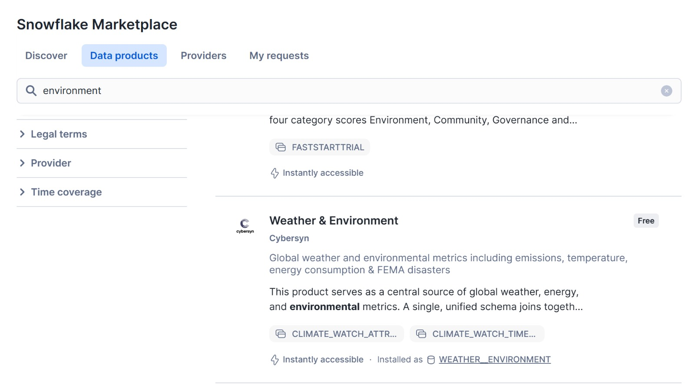
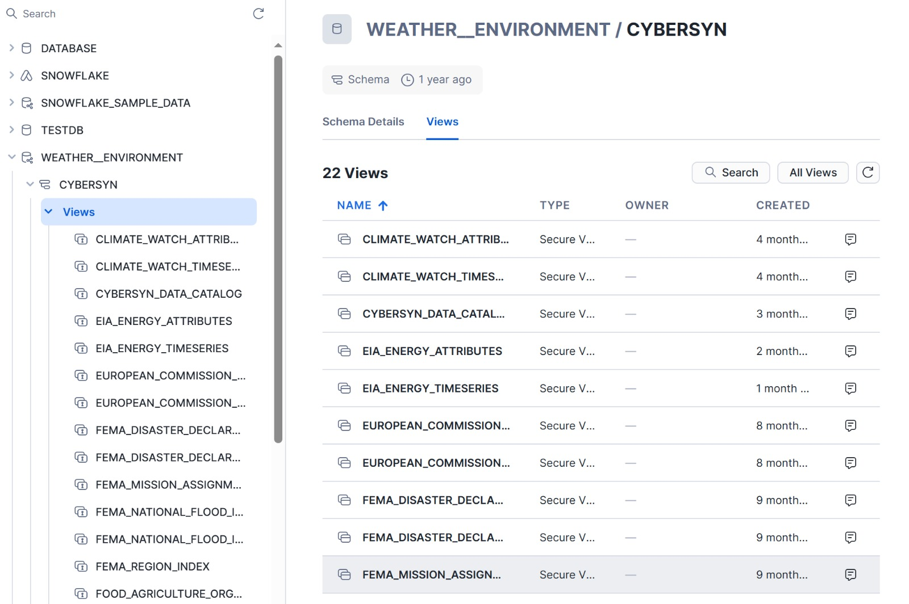

::: {.biz-value}
### Reconciliation Workflow

- **Question:** How can quoted and invoiced amounts be compared across disconnected operational sources?
- **Analysis:** Led a five-person team combining CSV orders, XML invoices, PostgreSQL supplier data, and NOAA weather data in Snowflake. Aggregated PO and invoice totals, then joined on PO and supplier IDs.
- **Result:** Consolidated 400K+ source records and produced a reconciliation table covering approximately 2,100 purchase orders, with quoted-minus-invoiced differences for exception review.
- **Scope:** Weather enrichment produced approximately 1,300 matched records. No measurable temperature relationship was observed in that subset; it does not describe every order or rule out all weather effects.
:::


## Introduction

Purchase orders, supplier invoices, and supplier records lived in three different systems and formats. To check whether suppliers billed what they quoted, the data first had to be brought into one place and matched order by order. This project built that pipeline in Snowflake: extract from CSV, XML, and PostgreSQL, load, transform with SQL, and produce one reconciliation table, then test whether an external factor, weather, explains the gaps.

---


## Objective

- Build ETL workflows to consolidate **400,000+ records** into a clean, analysis-ready dataset.  
- Integrate data across **PostgreSQL**, **Snowflake**, and **Python pipelines** to unify operational and financial information.  
- Support structured financial reporting by reviewing trends and relationships in the data.  
- Explore potential correlations between external drivers (e.g., weather fluctuations) and purchase orders using multi-source data.  
- Lead a five-person team using clear task ownership and coordinated delivery.

---

## Data Description

This case integrates operational, financial, and environmental data from multiple sources to support structured analysis of purchase orders and invoices.

The datasets used include:

### 1. Purchase Order Data (CSV – 41 Monthly Files)

- Line-level purchase order records  
- Includes quantities received, expected prices, supplier identifiers, and order dates  
- Used to calculate total purchase order amounts  

### 2. Supplier Invoice Data (XML)

- Invoice-level financial records  
- Includes invoice amounts, tax information, and transaction dates  
- Used to compare invoiced amounts against quoted purchase orders  

### 3. Supplier Data (PostgreSQL)

- Supplier-level reference data  
- Includes supplier location (ZIP code), identifiers, and related attributes  
- Used to connect operational data to geographic information  

### 4. Weather Data (Snowflake Marketplace – NOAA via Cybersyn)

- Daily temperature data  
- Used to explore potential relationships between weather fluctuations and purchasing behavior  

Together, these datasets allow us to:

- Reconcile purchase orders and invoices  
- Detect discrepancies between quoted and invoiced amounts  
- Examine whether external factors (e.g., temperature) are associated with purchasing patterns  

### Snowflake Marketplace Setup

The NOAA Weather & Environment dataset was accessed through Snowflake Marketplace (Cybersyn provider).  
The dataset was installed in Snowflake as the `WEATHER__ENVIRONMENT` database.

**Figure 1. Snowflake Marketplace – Weather & Environment Product**  
{#fig-marketplace}

**Figure 2. Installed Weather - Environment Database In Snowflake**
{#fig-weather-db}

---

## Case Overview

The objective of this case was to design and implement an end-to-end ETL workflow using Snowflake and Python. Rather than transforming data in local tools, most processing was executed directly within Snowflake to ensure scalability and performance.

The workflow consisted of:

1. Extracting data from CSV, XML, PostgreSQL, and Marketplace sources  
2. Loading the data into Snowflake  
3. Transforming the data into structured, analysis-ready tables  
4. Joining operational, financial, and environmental datasets  
5. Creating summarized outputs for reconciliation and correlation analysis  

The final dataset enables comparison of:

- Purchase Order Amount  
- Invoice Amount  
- Weather Conditions (by supplier ZIP code and date)  

This structure supports automated discrepancy detection and cross-source analytical exploration.

---

## Purchase Order Aggregation

Purchase order data was provided as **41** separate monthly CSV files at the line-item level. These files were consolidated into a single dataset and loaded into Snowflake.

Because each purchase order contains multiple line items, totals were calculated for each `PurchaseOrderID` by summing:

::: {.callout-note appearance="minimal"}
**POAmount = Σ(Received Quantity × Expected Unit Price)**
:::

This produced one summarized record per purchase order, reducing approximately 8,000+ line items to about **2,100** purchase orders. The result is a clean table of total quoted amounts by supplier and order date.

---

## Invoice Amount for Each Purchase Order ID

Supplier invoices were provided in XML format and converted into a structured dataset before being loaded into Snowflake.

From the supplier transactions data, invoice totals were extracted using the **Amount Excluding Tax** field. The data was organized by:

- PurchaseOrderID  
- SupplierID  
- InvoiceAmount  
- TransactionDate  

This created a comparable summary of invoiced amounts for each purchase order.

---

## Joining Purchase Orders and Invoices

The summarized purchase order table and invoice table were joined using `PurchaseOrderID` and `SupplierID`.

A new field, `invoiced_vs_quoted`, measures the gap between the quoted purchase amount and the invoice amount:

::: {.callout-note appearance="minimal"}
**invoiced_vs_quoted = POAmount − InvoiceAmount**
:::

Despite its name, the field is **quoted minus invoiced**: a positive value means the supplier billed less than quoted, and a negative value means the supplier billed more than quoted, which is the case to escalate. Renaming it `quoted_minus_invoiced` would remove that ambiguity.

The final reconciliation table contains approximately **2,100** matched records and provides a clear view of pricing differences across suppliers and transactions.

---

## Supplier Postal Codes

Supplier reference data was extracted from PostgreSQL and loaded into Snowflake. From this dataset, each supplier’s postal code was identified and standardized.

A simple reference table was created containing:

- SupplierID  
- `PostalPostalCode` (the source schema's actual column name)  

This table provides the geographic link needed to connect supplier activity with external data sources.

---

## Weather Data

To examine whether weather conditions were associated with purchasing activity, daily temperature data was added to the analysis.

A national ZIP code reference file was used to obtain latitude and longitude for each postal code. Each supplier ZIP code was then matched to the nearest NOAA weather station available in Snowflake Marketplace.

From the NOAA dataset, daily maximum temperature values were extracted. The resulting table, **supplier_zip_code_weather**, contains:

- ZIP code  
- Date  
- Daily high temperature  

Approximately **1,300** ZIP-date temperature records were generated.

This structure allows supplier transactions to be analyzed alongside daily weather conditions using shared ZIP codes and dates.

---

## Joining Everything Together

The final step combined all prepared datasets:

- Purchase order and invoice comparison table  
- Supplier reference data  
- Daily weather data by ZIP code  

The tables were joined using:

- Supplier ZIP code  
- Transaction date  

Only records with available temperature data were included.

### Result

The final dataset contains:

- ZIP code  
- Date  
- Daily high temperature  
- Purchase order and invoice comparison information  

Approximately **1,300** matched records were produced.

---

## Core SQL Logic

The reconciliation reduces to two aggregations and a join. A simplified version, with column names shortened for readability:

```sql
-- 1. One quoted total per purchase order (line items -> PO)
CREATE OR REPLACE TABLE po_totals AS
SELECT purchase_order_id,
       supplier_id,
       order_date,
       SUM(received_qty * expected_unit_price) AS po_amount
FROM   purchase_order_lines
GROUP  BY purchase_order_id, supplier_id, order_date;

-- 2. One invoiced total per purchase order (excluding tax)
CREATE OR REPLACE TABLE invoice_totals AS
SELECT purchase_order_id,
       supplier_id,
       transaction_date,
       SUM(amount_excluding_tax) AS invoice_amount
FROM   supplier_transactions
GROUP  BY purchase_order_id, supplier_id, transaction_date;

-- 3. Reconciliation: quoted minus invoiced, by order
CREATE OR REPLACE TABLE po_invoice_reconciliation AS
SELECT p.purchase_order_id,
       p.supplier_id,
       i.transaction_date,
       p.po_amount,
       i.invoice_amount,
       p.po_amount - i.invoice_amount AS invoiced_vs_quoted
FROM   po_totals p
JOIN   invoice_totals i
  ON   p.purchase_order_id = i.purchase_order_id
 AND   p.supplier_id      = i.supplier_id;
```

## Observation

After joining weather to the roughly 1,300 orders with matching temperature data, quoted-versus-invoiced gaps showed no visible pattern across daily high temperatures. This was a descriptive check, not a formal test, and it covers only the subset with weather coverage. Within those limits, weather does not explain the invoice discrepancies, which points attention back to supplier- and process-level causes.

## What I Would Add in Production

- **Data quality tests at every stage:** row counts in and out of each step, uniqueness of `purchase_order_id` in the totals tables, and null checks on amounts and keys.
- **Explicit handling of unmatched records:** purchase orders with no invoice, and invoices with no purchase order, are often the most important exceptions. An inner join silently drops both, so they belong in their own exception table.
- **Tolerance-based flags:** flag gaps above a threshold (for example, more than 2% or more than $500) so reviewers see only material differences.
- **Incremental loads and scheduling:** load only new monthly files and run on a schedule, using Snowflake tasks or an orchestrator, instead of rebuilding everything by hand.


