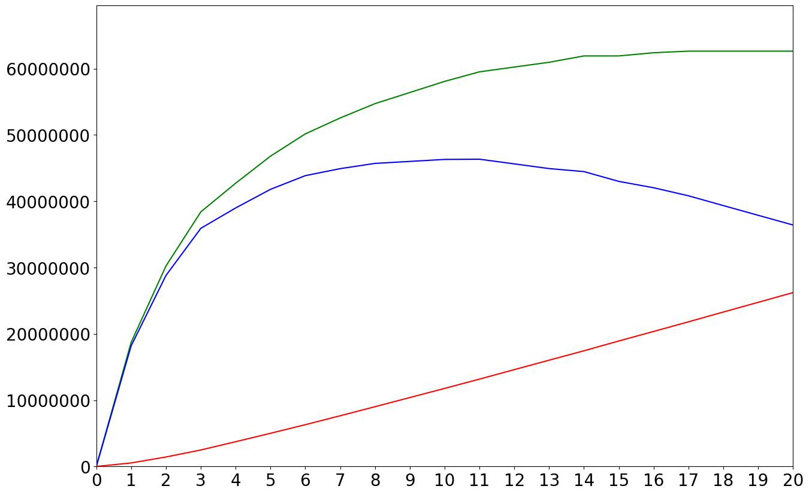
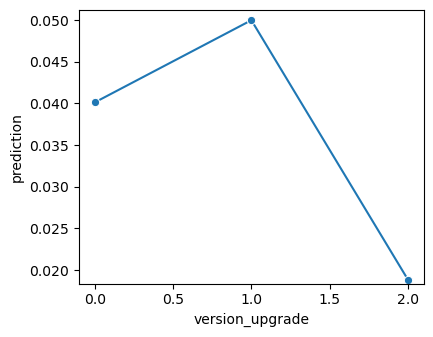
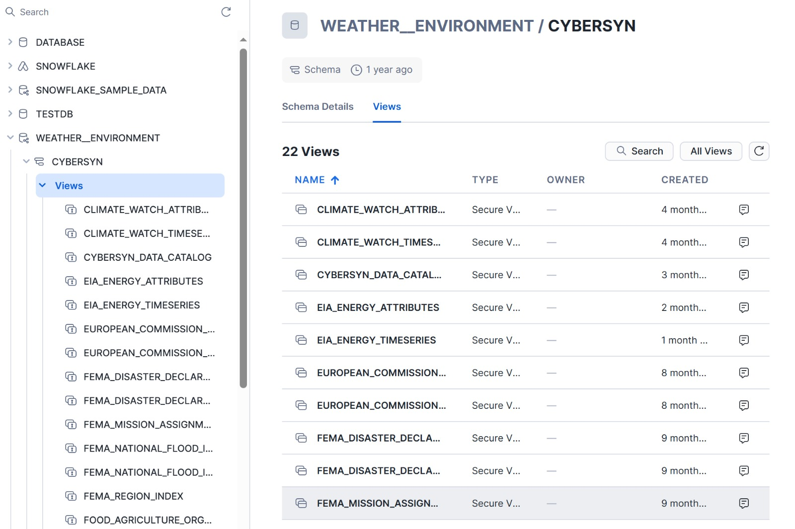

```{=html}
<div class="hero">

<div>
<h1>Tweety Chang</h1>
<p class="role">Associate Relationship Manager · Corporate Banking & Credit Analysis<br>Bank SinoPac, Los Angeles Branch</p>
<p class="lead">I support U.S. corporate lending and syndicated loan transactions: analyzing borrower financials, monitoring credit risk, and preparing credit memos for committee review. My background combines accounting (B.S.), business analytics (M.S., UC San Diego), and hands-on experience with SQL, Python, and Excel financial modeling.</p>
<div class="btn-row">
<a class="primary" href="projects.html">View Projects</a>
<a href="about.html">About & Experience</a>
<a href="https://www.linkedin.com/in/tweety-chang">LinkedIn</a>
<a href="mailto:ctweety15@gmail.com">Email</a>
</div>
</div>
</div>

<div class="stats">
<div class="stat"><div class="num">$40.5M</div><div class="lbl">Est. annual savings from fraud model cutoff</div></div>
<div class="stat"><div class="num">62%</div><div class="lbl">Fraud captured at a 1.7% false-positive rate</div></div>
<div class="stat"><div class="num">400K+</div><div class="lbl">Records reconciled in a Snowflake ETL pipeline</div></div>
<div class="stat"><div class="num">EN / 中文</div><div class="lbl">Bilingual credit reporting</div></div>
</div>
```

## Featured Projects

```{=html}
<div class="card-grid">
<a class="pcard" href="credit_card_fraud_detection.html">

<div class="body">
<span class="tag">Risk Control</span>
<h3>Credit Card Fraud Detection</h3>
<p>LightGBM model on 97K transactions, validated out-of-time, with a review cutoff set by net financial impact.</p>
<div class="metric">62% fraud caught · $40.5M est. savings</div>
</div>
</a>
<a class="pcard" href="Intuit_Quickbooks_Upgrade.html">

<div class="body">
<span class="tag">Profitability</span>
<h3>Campaign Profit Optimization</h3>
<p>Response model and break-even targeting rule for a 75K-business upsell campaign.</p>
<div class="metric">$1.23M projected profit · ROME 3.63</div>
</div>
</a>
<a class="pcard" href="database_management.html">

<div class="body">
<span class="tag">Controls & Data</span>
<h3>PO–Invoice Reconciliation in Snowflake</h3>
<p>ETL across CSV, XML, PostgreSQL, and Marketplace data to flag quoted-vs-invoiced variances.</p>
<div class="metric">400K+ records · ~2,100 POs reconciled</div>
</div>
</a>
</div>
```

```{=html}
<p style="text-align:center; max-width:none"><a href="projects.html">See all projects →</a></p>
```
